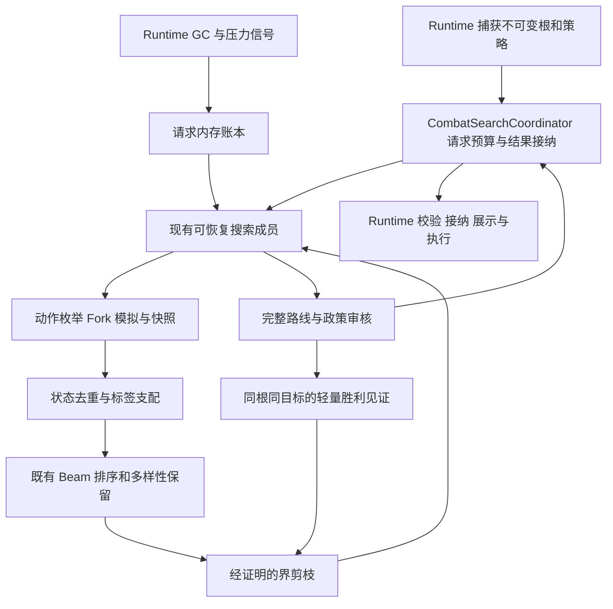

# 单人搜索质量与性能优化方案

方案日期为 2026-11-07。实施进度及当前验证证据见 [CODEX_HANDOFF.md](CODEX_HANDOFF.md)。

目标是在相同资源约束下，更早交付合规路线、找到更好的完整胜利、降低峰值存活内存和长尾停顿。单人继续以战斗结束为预测目标；预算耗尽可以返回明确标记的部分结果，但不能把固定三回合、低估未来风险或扩大预算当作优化。

本文件是 [CODEX_HANDOFF.md](CODEX_HANDOFF.md) 指定的当前单人设计附件。实施进度只在 handoff 维护；以下 S0–S5 是本专项的施工依赖，不接续历史同名 P/U 阶段。

## 1. 现状与主要切入点

| 已有能力 | 当前代码 | 本次如何利用 |
|---|---|---|
| 单多人共用搜索、单人完整战斗目标 | `SearchEvaluationPolicy`、`RouteEvaluationWindow` | 保留完整目标及跨窗口不可比较规则 |
| 可恢复搜索成员和稳定提交边界 | `CombatBeamSolver.Phases` 的 `IResumableSearch`、`SearchMemberExecutionSession` | 后续调度复用 session，不再造搜索器 |
| Beam、不同宽度成员、Novelty、Smart 药水审计 | `CombatSearchCoordinator.*`、`BeamWidthPortfolio` | 在现有总预算中协调；保持正式结果审核 |
| 成员内胜利界与同根无药胜利见证 | `CombatBeamSolver.Retention`、`OptimizationBounds`、`SearchOptimizationSession` | 先统一证明口径，再扩展覆盖范围 |
| pinned 回复上界 | `PinnedHealingBound` | 当前是窄白名单，不是所有牌组都适用的回复证明 |
| 两级转置表和 Pareto 标签 | `Transpositions`、`TryAcceptTransposition`、`TryMarkExpandedState` | 保留策略/历史维度，不退化为“同哈希只留最高分” |
| 多种防守、进攻、启动、循环与跨回合保留渠道 | `BeamRetentionPolicy.*`、`Retention`、`BeamRanking` | 整合已有保留规则；单人的改动需独立验收 |
| 波次内存准入、回收和 NoGC 恢复 | `SearchWaveMemoryPolicy`、`SearchMemoryPressureSignal`、`SearchGcPolicy.*` | 先减少存活对象和分配，再调整回收调度 |
| 请求/阶段工作量、离线宿主、路线独立重放 | `SearchRequestObservation`、`SearchRequestWorkTotals`、`U0U1PinnedHarness` | 补少量缺失字段，复用验证入口 |

静态代码给出的优先调查点：

- `Prune` 已明确要求先排序再应用胜利界，且剪掉后不补位。提前过滤可能改变 Beam 和转置竞争，不能作为普通等价重构。
- `SearchNode` 保存父链和懒加载动作数组；`SimulationSnapshot.ReleaseSimulator` 只清除模拟器引用。释放模拟器不等于整条节点链、数组和进程工作集立即释放。
- `SearchOptimizationSession` 保存的 `SolverResult` 已由 `SelectedSearchPlan` 与 `SolverSnapshot` 切断父链和模拟器引用。见证仍可复用这组值，减少临时分配应先查搜索过程中的对象。
- `ResetRebuildableCaches` 与循环/有序变化的语义账本已分开。回收时重置语义账本会让同一分支再次获得搜索额度。
- 通用后态 hydration 仍默认关闭。当前交接记录未证明净收益；不以“命中更多”为由直接扩大缓存。

以上是代码观察与待测假设。旧多人热点、旧夹具收益不能替代当前单人基线。

## 2. 目标架构

继续采用现有 Beam 主干、可恢复成员和请求级协调器。新增内容应是少量值合同与策略函数，避免先把全部 partial 文件搬家。



图中次序是首轮迁移需要保留的主干；终局、Choice、循环租约等现有专用入口仍执行原合同。将界前移是后续独立实验。

| 职责 | 落点与建议合同 | 边界 |
|---|---|---|
| 质量与可比性 | 复用 `SolverInterimResultOrdering`、`FinalPlanOrdering`、Coordinator `ResultPolicy`；薄封装 `SearchObjectiveContext` | 不另写一套总分公式；正式排序仍为真源 |
| 界与适用证明 | 新增小型 `SearchBoundContracts.cs`，将两处现有界通过同一评估入口暴露 | `Certified / Unknown / NotApplicable` 明确区分；启发式不转换成证明 |
| 当前可行解 | 改进 `SearchOptimizationSession`，增加纯值 `FeasibleRouteWitness` | 只由完整合规胜利收紧；动作和 Choice 值深复制，不保留模拟器或执行权 |
| 内存生命周期 | 在现有 `SearchRunContext` / execution session 内增加所有权计数及可选 `SearchMemoryLedger` | 首先计数和核对，不引入第二套 Dispose 或 GC 管理器 |
| 成员调度 | 现有 Coordinator、`IResumableSearch.Step`、请求工作账本 | 同一预算，不为新阶段重置时间、节点、重放或药水审计额度 |
| 模拟与身份 | 现有 Engine / Prediction / 状态键 | 不改变真实对象隔离、Fork/COW/remap 与未知语义边界 |

所有新类型名为建议名。现有类型可无歧义承载职责时直接扩展，禁止为了套架构重复一份状态。

建议的界合同至少包括：目标身份、根代次、适用候选类别、已证明的质量前缀、下界值、证明种类/版本和拒用原因。`Unknown` 使用显式状态，不将 `int.MaxValue` 同时解释为无限回复与不可达代价；对原实现用适配层迁移，并保留饱和算术。

目标身份必须覆盖真正影响证明的策略：单人/多人目标、评价范围、药水限制与来源口径、成长/遗物目标、偷窃策略、Boss HP 策略及相关模型版本。缓存是否增加某个字段取决于它是否改变模拟后态、结果或证明；分别核对 `CombatTransitionMemo.CapturePolicyIdentity`、continuation 和结果缓存，不把所有实验开关机械塞入同一个键。

## 3. 搜索质量的约束

质量先按当前政策和评价窗口判定，再调用既有比较器。普通单人的主质量轴包含完整胜利、保命资源、战略 HP、成长目标和胜利回合；跨药水比较还包含机会成本。不能将这一顺序简化成“最终 HP 越高越好”或“越早赢越好”。

需要保留四种不同量：

1. 已实际模拟的累计受伤、回复、保命和药水消耗。
2. 完整合规路线产生的可行解质量。
3. 对所有合规后续都成立的乐观界。
4. 启动、毒/延迟效果、抽牌、保留与未来资源等排序估值。

第 4 类只用于扩展顺序、保留席位及调度，不能冒充第 1–3 类。终局不再计算未来战斗能力收益，实际局外成长仍按原规则保留。

质量优化从以下失误类型入手，而不是先提高 Beam：

- 立即进攻挤掉低成本启动，导致后续回合损失更大。
- 短期低战损挤掉能完成战斗的路线，或部分路线被当成完整胜利比较。
- 防守、延迟收益、保留/循环出口集中在同一首动作，被相似分支占满席位。
- Smart 审计发现更快胜利，却没有满足实际药水机会成本。

先测已有保留渠道在哪一层丢失正确候选，再合并重复渠道或调整现有席位。保护全局质量领先、防守可行和有证据的启动/延迟候选；不为每张特殊牌永久增加一条无上限通道。

## 4. 上下界设计

### 4.1 先固定方向与适用域

下文以“代价越小越好”为方向。对同根、同目标、同硬约束的完整合规路线，设节点 `n` 的最佳可达代价为 `J*(n)`，则有效乐观下界满足 `L(n) <= J*(n)`。请求已找到的合规完整路线给出全局可行上界 `U`。这条全局路线不一定经过 `n`，所以不能声称它也是该节点的可行续接。

仅当前置质量轴已证明不可能更好、且该目标维度的 `L(n) > U` 时剪枝。等号默认保留；只有胜利回合等后续轴也有有效界并已严格落后，或所有剩余排序都不可能改善时，才允许处理相等值。对“分数越大越好”的排序量不要直接套用这个不等式。

没有合规胜利时，上界为未知。保留合法部分结果供展示/后续搜索，但它不能成为完整胜利剪枝的上界。政策不合规、风险未解析、过期根、跨评价窗口的结果都不能收紧见证。

### 4.2 第一批界保持小而可证明

| 界 | 实施方式 | 不能假定的条件 |
|---|---|---|
| 战略 HP 下界 | 统一现有 `StrategicHpLowerBound` 与 `OptimisticHpLowerBound` 的返回合同，先保持数值和调用位置 | 累计受伤不是不可恢复代价；回复、最大 HP、保命和 Boss 减免必须按原口径 |
| 剩余回复上界 | 保留 `PinnedHealingBound`；在已审计组件上逐步扩大封闭证明 | 未知牌、生成来源、第三方补丁、事件监听或分支变化不能当作零回复 |
| 最早胜利回合 | 先用已成立的回合下界，且 HP 等前置轴不可能改善时才比较 | 仅凭剩余敌人 HP / 当前攻击力，不能推导未来必需回合数 |
| Smart 资格界 | 根据实际槽位成本、已支付成本、可生成来源和无药基线判断是否还可能满足资格 | 混沌生成药水不能按根库存“次数 × 单价”收费；强制指令不能漏掉 |

HP 界的思路是：已累计受伤减去已兑现回复，再乐观计入所有仍可能兑现的回复，并经过现有战略 HP 函数处理。若有有效回复容量证明 `Hmax`，可将当前可恢复缺口中的乐观回复限制为 `min(当前缺口, Hmax)`；没有证明时保持现有宽松界。该式只在其已经审计的 HP/目标语义内使用，不直接扩展到可重复成长、动态最大 HP 或新增回复机制。

示例：在没有 Boss 减免、保命、成长和最大 HP 变化的简化场景，累计损失 8、已回复 2、当前缺口 6。若证明未来最多回复 3，则下界为 3；当前完整胜利代价为 2 时可以剪掉。未知回复时应允许补满缺口，下界为 0，不能剪掉。若下界和已知胜利都是 2，仍可能存在更早或其他维度更好的胜利。

回复能力证明按组件闭包扩展：根来源清单 + 已核对 native 版本/补丁 + 分支动态来源校验 + 最大可重复次数。有限组件相加时允许保守重复计入以保持乐观；相互依赖、生成未知或可无限循环时返回未知。先扩展一个实际命中较多的来源族，用固定反例验证，再考虑下一个。

暂不实施通用“不可避免未来伤害”“最多造成伤害”硬界。费用变化、生成、抽牌、反伤、召唤和敌人状态机使这些证明很容易失效。需要时先在封闭小域证明，否则只提供排序提示。

### 4.3 见证发布与停止条件

- 首轮保留现有见证产生时点；需要提早发布时，必须复用完整政策审核，不能从预测预览直接发布。
- 并行成员在确定提交边界读取一版见证；记录版本号，避免线程快慢任意改变同一批的剪枝时点。worker 不自行写全局最优结果。
- 新根即撤销旧证明。旧路线只有经既有身份检查或新根重放后，才产生该根的新见证。
- 达到某个主质量轴的理论最优，只能停止无法改善该轴的工作。成长、遗物、药水、回合及 tie-break 尚可能改善时，不宣称全目标最优。
- Beam 已启发式丢弃分支；即使活跃前沿全部被界压住，也不构成全局最优证明。可以报告“已知最好胜利”和停止原因，不能报告全局最优差距。

## 5. 剪枝与搜索成本

| 层次 | 可执行优化 | 必须保留的区别 |
|---|---|---|
| 合法性与已知边界 | 复用动作枚举、处理完全相同动作身份的重复工作 | 未知效果是预测边界，不是假定无效动作 |
| 状态等价/标签支配 | 审计完整状态键、RNG、Choice、历史计数与路径目标；保留非支配标签 | 更多 HP/能量、较少药水或更高分，单独都不能证明未来支配 |
| 已证明的界 | 先保留排序后过滤、不补位；减少后续展开 | 不等同于 Beam 估值淘汰 |
| 启发式保留 | 去除重复保留渠道、改善防守/启动/延迟多样性 | 有质量风险，必须独立开关和同预算比较 |
| 循环与调度租约 | 保留既有每回合/每族总账与出口机会 | 缓存清除不能补发额度；“本步没进展”不等于未来没收益 |

状态去重继续以当前模型键为基础。128 位指纹不是形式上的无碰撞证明；为碰撞注入和键缺字段提供诊断验证。新增声称“严格等价”的优化必须说明键覆盖与二次语义核验条件。没有证明可交换的动作，不能按牌名或最终 HP 把不同顺序直接合并。

转置表中增加目标/界时，区分“状态已见过”“标签被支配”“完整求解”“只有下界”。Beam 中被丢弃或预算停止的状态不能标为已经完整求解，不能把该值当作精确答案向上回传。

速度工作按当前单人阶段计量选择：

1. 对节点重复读取的不可变特征计算一次；循环内减少 LINQ、临时列表与排序键构造，先证明相同输入/顺序/结果。
2. 对 Snapshot、Fingerprint、Fork 分别计量；优先复用同一分支稳定边界内的计算，禁止读 live 值或删除指纹语义字段。
3. 增量指纹/估值只在写入失效边界完整时试点；不支持的路径继续全量计算。调试模式与全量重算对照。
4. 枚举很多 Choice 的场景可评估分批生成，但必须保留原选择顺序、checkpoint 所有权及未消费分支；不得悄悄截掉选项。
5. 界前移、延迟完整 Snapshot、提前 top-k 都作为单独行为实验。现有排序和支配读取哪些字段先列清楚；不得为了省一次 Snapshot 用不足信息代替它。

每种剪枝记录尝试次数、适用/拒用原因、命中、额外计算成本及最终工作量。高命中但成本更高的规则不默认启用。

## 6. 内存管理与并行

### 6.1 按生命周期管理，而不是按“缓存”统称

| 生命周期 | 内容 | 释放/保留策略 |
|---|---|---|
| 请求根 | 冻结模型、策略、只读根索引 | 共享只读；请求完全排空后由拥有者释放 |
| worker 临时工作 | Fork、动作/Choice checkpoint、batch 缓冲 | take/transfer/dispose 单一所有权，取消和异常对称清理 |
| 活跃前沿 | 当前 frontier、待提交结果、必要可恢复快照 | 确认不再用于展开/续接/最终物化后释放模拟器 |
| 路径与结果 | 父链、动作、Choice、累计资源、最终质量 | 首先避免反复物化动作；仅请求外结果/见证转纯值，深复制可变集合 |
| 可重建缓存 | threat/coverage/stand-pat、部分转置信息 | 现有排空边界按用途清除；不得清除仍被 prune 依赖的答案 |
| 语义账本 | cycle/ordered-mutation 租约、已支付搜索额度 | 随所属请求保存，不能随 GC checkpoint 重置 |

首批工作：统计创建/转交/释放的模拟器和 checkpoint 数、峰值活跃数量、父链及动作数组的保留来源，检查请求结束及取消后的拥有者计数归零。不要为了统计持有对象的强引用集合，避免诊断本身制造保留。

`FeasibleRouteWitness` 优先从请求级见证提取纯值摘要；如果消费者需要路线，则共享不可变动作值。必须先审计消费者是否还依赖 `BestNode`、资源账本、continuation 与末态，不直接删字段。

路径 arena、父索引化、整套模拟器池化暂缓。只有分配和保留证据表明父链是主要成本，才做单独阶段；祖先排名、循环租约和 replay 都依赖当前结构，整体替换风险大。临时数组/列表池可先小范围使用，但设置容量上限、归还时清空引用、禁止归还后继续读取。

### 6.2 内存压力流程

```text
到达既有安全提交边界
  → 暂停新波次，排空已启动 worker
  → 保留当前有效结果、前沿与语义账本
  → 释放未保留模拟器和可重建缓存
  → Runtime 选择既有回收/NoGC 恢复路径
  → 重新评估下一波所需余量
  → 能继续则继续；否则带真实停止原因交付最佳已审核结果
```

后续可按“观测的父节点分配高水位 × 在途父数量 + 提交/prune 暂存 + 安全余量”改进准入。它只是预测，单次原生动作不可中断，不能承诺硬内存上限。所有高水位与保留字节估计要考虑 COW 共享，不能把每个分支全量相加当作真实堆大小。

在压力下优先缩小在途波次、延后额外成员、释放失去用途的状态。不得用减少逻辑 Beam 席位伪装成内存等价优化；如确实引入降级模式，必须单列质量变化和停止/降级原因。

并行继续只操作私有分支，保留父 Fork gate 和确定提交顺序。配置 DOP 是上限，实际波次由既有内存/帧压力准入控制；不能给每个成员各开满 DOP。减少排队缓存和锁持有时间，先定位串行 Fork、模拟及提交阶段各占多少，再考虑并行方案。

不在 Search 中调用 `GC.Collect`，不扩大 NoGC 区域、不自动清空系统工作集，也不恢复按碎片比例强制压缩的旧路径。

## 7. 有限预算下的完整战斗搜索

在内存与界的合同稳定后，再做单人专属的请求调度实验：

1. 利用已有合法续用/重放候选建立可行路线；失败仍由主搜索接管，重放计入原预算。
2. 让普通全战斗成员持续推进，优先获得合规完整胜利；前台有合法部分结果时可以更新，但保留未完成标签。
3. 获胜后在同一请求剩余额度中改善战略 HP、药水机会成本、成长与回合；见证为其他成员提供有效界。
4. 调度使用可恢复 session，避免每轮从根重新做同样工作。评分停滞时允许现有 Novelty/不同宽度成员探索不同路径。

不是将多人选择性深入比例套到单人，也不新增固定回合上限。时间片先以稳定的父提交/转移数量轮转，计时作为截止与诊断；随后才研究按单位成本收益分配。

收益只能在相同目标类别内衡量。完整胜利、消除死亡风险、满足硬指令与普通分数提升分开记录；不能用启发式上涨压掉尚未兑现的启动路线。为探索成员保留有限机会，但总预算不增加。

新调度减少某个基线成员的工作份额时，无法静态保证仍找到旧路线。因此先作 opt-in；用同根同预算的质量结果验收，不能仅依据“保留了基线通道”宣称无退化。

## 8. 实施顺序与验收

| 阶段 | 工作和交付 | 进入下一步的条件 |
|---|---|---|
| S0 基线与目标 | 固定当前单人输入、实际目标比较器和预算；补界拒用原因、首个审核胜利、峰值活跃状态计数 | 能分别解释结果质量、工作量、墙钟和存活内存；确认具体热点 |
| S1 生命周期与低风险成本 | 优先修复已定位的多余保留/重复分配；轻量见证、临时缓冲和局部特征复用按收益选择 | 结果身份、RNG 和逻辑工作不变；异常/取消/重放所有权成立；测得相应成本下降 |
| S2 统一并扩展证明 | 适配现有两类界、明确目标身份；选一个真实有收益的回复来源族扩展 | 反例与小域穷举不误剪；未知回退；同预算不退化且减少有效工作或改善延迟 |
| S3 剪枝与去重成本 | 优化完整键/标签查找、界计算复用和现有保留重复工作；提前剪枝单独实验 | 对等价部分保持身份，对行为部分证明所测输入质量不退化；记录收益来自哪里 |
| S4 单人搜索调度 | 复用 session，改进完整胜利到达时间和难场景多样性 | 独立保留输入上获胜/损失/药水质量不退化；首胜与尾部成本达到预设目标 |
| S5 集成与交接 | 撤掉无收益实验；保留有证据的默认值，更新架构与 handoff | 最小相关回归通过；涉及 Runtime GC/帧影响时补定向实机证据 |

依赖为 S0 → S1/S2 → S3 → S4 → S5；S1 与 S2 可按基线热点决定先后。每阶段可独立回滚，不把内存、评分、剪枝和调度同时改在一个难以归因的实验里。

下一次建议先完成 S0，并只选择一个 S1 热点或一个 S2 证明扩展。首个交付无需重做整个调度器；当前目标是得到第一个结果可信、成本下降的闭环。

### 8.1 需要观测的指标

| 类别 | 指标与口径 |
|---|---|
| 质量 | 完整胜利/部分/失败、停止原因、累计受伤/回复、保命消耗、战略 HP、药水实际机会成本、目标达成、胜利回合、独立重放末态 |
| 响应 | 根捕获后首个合法预览、首个已审核完整胜利、最终已接纳结果、取消到 worker 排空；阶段起止写清楚 |
| 工作 | expanded parents、逻辑 transitions、真实模拟次数、重放、去重/界/启发式淘汰分开；不能用逻辑命中冒充实际跳过模拟 |
| 内存 | 累计分配、采样峰值托管堆、进程 private bytes/工作集、峰值活跃模拟器、缓存/动作数组条目、回收后仍存活的对象来源 |
| GC/交互 | Gen2、GC pause、NoGC 丢失/恢复、可见游戏帧间隔；离线宿主没有 UI 帧证据 |

累计分配不等于存活内存，托管堆不等于工作集，线程累计阶段耗时不等于墙钟。内存采样可能漏掉短时峰值；报告采样间隔与环境，不输出假精确的请求私有堆占用。

### 8.2 比较方式

- 等价性能修改：同根、同版本、同 DOP/NoGC、同预算，完整动作/末态/RNG/工作量相同，再比较性能。执行现有 [性能护栏](PERFORMANCE_GUARDRAILS.md)，超过噪声范围的退化不能四舍五入消失。
- 剪枝或调度修改：工作量可能减少、路线也可能改善。作为算法变化单独验收，使用既有目标比较器、完整末态重放和相同预算比较；不能伪装成固定工作提速。等质但不同路线也明确标注。
- 开发先用受影响的窄夹具；形成有收益候选后，再按既有护栏串行做独立进程 A/B。不并发测速，不反复跑全套矩阵。
- 不以降低预算、Beam、DOP 或只给候选换 GC 设置制造优势。压力准入导致实际并发下降时单列记录。
- 质量要求是所测输入中不失去基线已知合规胜利，不劣化正式质量排序；同时列出原始 HP 和药水变化，不能让聚合分数隐藏代价。保留少量未用于调参的输入作最终检查。
- 不先承诺固定百分比。S0 后为实际热点确定有意义的目标；命中率高、分配少或节点少，均不能单独证明总体更快。

### 8.3 最小充分验证

优先复用 [TEST_MATRIX.md](TEST_MATRIX.md) 与以下现有入口，不新建一套通用测试平台：

- `U0U1PinnedHarness upstream-search`：已有界、见证、未知回复/补丁回退。
- `U0U1PinnedHarness p2-quality --fixture setup-single`：单人晚启动与完整胜利。
- `strategic-tail`、`multiplayer-window`：终局未来值、共享窗口和单人长路线的受影响部分。
- `TranspositionFrontierChecks`、`StateFingerprintChecks`、`SnapshotReleaseChecks`、`ExpansionBatchChecks`：对应状态键、标签和所有权改动。
- 仅改回收/准入时调用相关 `CombatSolver.GcPolicyChecks` / `CombatSolver.WavePolicyChecks` 子项。

按风险选择单人代表输入，优先复用已有夹具，仅在缺少时补入现有 harness：低 HP 保命、受伤后回复、Smart/混沌补槽、延迟/保留、零费循环与洗牌、Choice 多分支、多敌人目标变化，以及一个长战斗/大牌组。每项可以同时覆盖多个风险，不机械做笛卡尔积。

为硬剪枝额外使用小型封闭域 oracle：无启发式丢弃地穷举到证明终局，对照界开/关，确认每个被剪节点都不能改善见证；穷举未终止、触到预算或遇未知效果时结果为未证明。原生路线重放负责验证模拟末态，两者不互相替代。

关键反例：未知回复不能当零；损血换成长/费用不能按更多 HP 支配；相同显示状态但 RNG/历史/费用修正不同不能合并；下界相等仍保留更早或其他维度更好路线；回收不能补发循环额度；取消和并行收尾不留下活跃快照。涉及共享核心时加一个多人默认策略隔离检查即可起步，按失败范围扩展。

## 9. 接手任务说明

从 `CODEX_HANDOFF.md` 进入本方案。先检查工作区和当前源码，不以本文基线 SHA 覆盖后续修改；保留 `game-body` 既有删除及其他任务改动。

按交接记录从首个未完成阶段继续，保持单人完整战斗、既有总预算和正式排序，优先用现有离线宿主和定向合同验证。未知效果按现有预测边界处理。每批记录行为、验证证据和覆盖范围。
